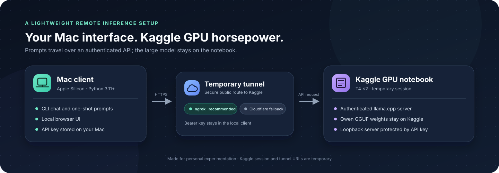
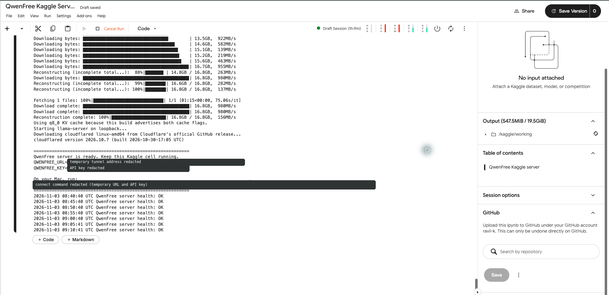
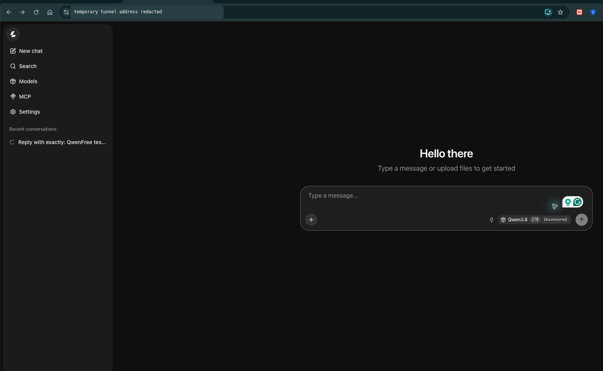
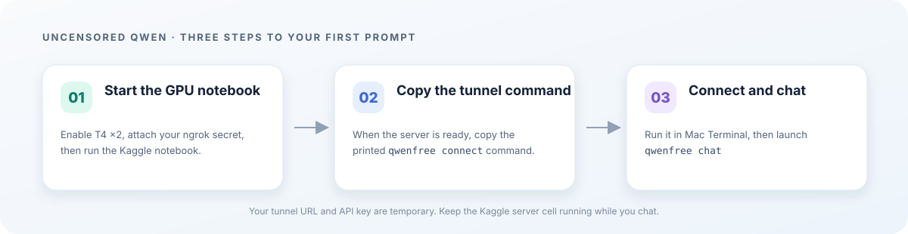

# QwenFree — Uncensored Qwen on Kaggle

QwenFree is an open-source Mac client for the community **uncensored
Qwen3.8-27B** GGUF. The model runs in a temporary Kaggle GPU notebook; the Mac
client sends prompts to its authenticated server. An optional, explicitly
downloaded model of at most 4B parameters can run locally on Apple Silicon when
the remote session is unavailable.

Kaggle GPU access, queueing, quotas, and session length depend on current
availability and account limits. Check Kaggle's current [Notebook
documentation](https://www.kaggle.com/docs/notebooks), [GPU usage
guide](https://www.kaggle.com/docs/efficient-gpu-usage), and [Terms of
Use](https://www.kaggle.com/terms) before starting. Cloudflare Quick Tunnels
are for testing and development; check their [current limits and
terms](https://developers.cloudflare.com/tunnel/get-started/quick-tunnels/).
Free tiers and interfaces can change.

The default weights are a community fine-tune, not an official Qwen release.
“Uncensored” describes that community model; it does not guarantee how it will
answer every prompt. Read the [community model card](https://huggingface.co/JonathanColetti/Qwen3.8-27B-Uncensored)
and the [GGUF repository](https://huggingface.co/JonathanColetti/Qwen3.8-27B-Uncensored-GGUF)
before use.



## Architecture

```text
Mac (qwenfree CLI or local web UI)
    │ HTTPS + API key
    ▼
Temporary public tunnel (ngrok recommended; Cloudflare Quick Tunnel fallback)
    │
    ▼
Kaggle Notebook ── loopback ── llama-server (CUDA, GPU T4 x2)
                                      │
                                      └── GGUF weights downloaded on Kaggle
```

The tunnel URL is temporary. The API key protects the model API. The client
stores that key in `~/.config/qwenfree/config.toml` with mode `0600`; the web
browser never receives it.

## Run QwenFree step by step

These screenshots show the Kaggle server reporting healthy and the QwenFree
chat page with the uncensored Qwen model selected. Temporary tunnel addresses
and API keys are masked.

### Kaggle server ready



### QwenFree chat page



### 1. Start the Kaggle GPU server

1. Sign in to Kaggle and download [`notebooks/kaggle_server.ipynb`](notebooks/kaggle_server.ipynb).
2. In Kaggle, choose **Create → New Notebook**, then **File → Import Notebook**.
3. Open **Settings / Session options**. Set **Accelerator** to **GPU T4 x2** if
   it is available to your account.
4. Turn **Internet** on. The menu says **Turn off internet** when it is already
   enabled; if it says **Turn on internet**, click it.
5. For the recommended streaming tunnel, add an `NGROK_AUTHTOKEN` secret under
   **Add-ons → Secrets** and attach it to this notebook. Without it, QwenFree
   tries a Cloudflare Quick Tunnel, which buffers each answer until generation
   finishes.
6. Leave `HF_TOKEN` unset unless the Hugging Face model repository asks for
   access. `QWENFREE_API_KEY` is optional; the notebook makes a temporary key
   if you do not set one.
7. Use **Run → Run All** and keep the session connected. The first run builds
   llama.cpp and downloads the model; both steps can take a while. CUDA may
   appear to pause at one percentage while it compiles a large kernel.
8. Wait for `QwenFree server is ready` and the health checks. Copy the exact
   `qwenfree connect ...` command printed by the final cell. Keep that cell
   running while you chat.

### 2. Install the Mac client

1. Open Terminal on an Apple Silicon Mac with Python 3.11 or newer.
2. Clone this repository and enter the project directory:

   ```bash
   git clone https://github.com/ravii-k/uncensoredqwen.git
   cd uncensoredqwen
   ```

3. Run the setup script. It creates `.venv`, installs QwenFree, and checks the
   Mac:

   ```bash
   ./scripts/mac_setup.sh
   ```

4. Activate that environment in this Terminal window:

   ```bash
   source .venv/bin/activate
   ```

### 3. Connect and chat

1. Paste the exact connect command from the Kaggle output into Terminal. It
   contains the temporary tunnel URL and API key; keep it private:

   ```bash
   qwenfree connect https://YOUR-TUNNEL-URL --key YOUR_API_KEY
   ```

2. Start a terminal conversation:

   ```bash
   qwenfree chat
   ```

3. Or open the browser chat on your Mac:

   ```bash
   qwenfree ui
   ```

4. In the browser page, check that **Qwen3.8 27B Uncensored** is selected,
   enter a prompt, and send it. If the Kaggle session stops, rerun the notebook
   and connect with its new URL and key.

For Kaggle menu details, secret setup, and recovery steps, see the full
[Kaggle setup guide](docs/KAGGLE_GUIDE.md) and
[troubleshooting guide](docs/TROUBLESHOOTING.md).



## Mac requirements

Use an Apple Silicon Mac with macOS, Python 3.11 or newer, and an internet
connection. Keep at least 20 GiB free for comfortable operation. The setup
script checks the Mac and Python architecture, asks before installing
Homebrew or Python when needed, creates `.venv`, installs QwenFree, and runs
`qwenfree doctor`. The optional local model pull refuses to run below 15 GiB
free.

## Tunnel choice and streaming

Add and attach an `NGROK_AUTHTOKEN` Kaggle Secret for the recommended tunnel.
The notebook prefers ngrok when it can obtain a URL and falls back to
Cloudflare Quick Tunnel otherwise. Check ngrok's [current free-plan
limits](https://ngrok.com/docs/pricing-limits) and [Terms of
Service](https://ngrok.com/tos).

Cloudflare Quick Tunnels do not support Server-Sent Events (SSE), so QwenFree
uses a completed response for `trycloudflare.com` URLs. It prints a notice
because long answers can take time to appear. The buffered request defaults to
512 output tokens; set `QWENFREE_MAX_TOKENS` in the Mac environment to change
that limit. See [Cloudflare's current Quick Tunnel limitations](https://developers.cloudflare.com/tunnel/get-started/quick-tunnels/).

If a Kaggle clone reports `Could not resolve host: github.com`, check that
Internet is enabled in the active notebook session. The Kaggle guide explains
the Settings menu wording and how to retry. The bootstrap also adds Kaggle's
NVIDIA driver directory to CMake's search path, which fixes the missing
`CUDA::cuda_driver` target seen on the first build. See
[troubleshooting](docs/TROUBLESHOOTING.md) for both issues and other fixes.

## Commands

| Command | What it does |
| --- | --- |
| `qwenfree connect URL --key KEY` | Check the remote health endpoint and save private connection settings. |
| `qwenfree chat` | Start an interactive streaming terminal chat. |
| `qwenfree ask "question"` | Ask once; accepts piped input and `--file PATH`. |
| `qwenfree ui` | Run the local browser chat on `127.0.0.1:8765`. |
| `qwenfree status` | Check the saved remote connection. |
| `qwenfree doctor` | Check Mac compatibility, disk, RAM, config permissions, and remote status. |
| `qwenfree disk` | Show QwenFree config, history, model, and cache storage. |
| `qwenfree clean` | Remove history and cache after confirmation; keeps config and models. |
| `qwenfree local pull` | Verify a selected small Q4 GGUF and ask before downloading it. |
| `qwenfree local start`, `stop`, `status` | Manage the optional local llama.cpp server. |

Chat commands include `/reset`, `/system <text>`, `/save`, `/temp <0-2>`,
`/ctx`, and `/exit`. Use `--no-history` with `chat` or `ask` to opt out of
local JSONL history. History is capped at 50 MiB.

### Optional local fallback

The local fallback is not downloaded or installed automatically. Choose an
exact Hugging Face repository and Q4 GGUF filename; QwenFree verifies the live
Hub file list, size, quantization, and parameter count before asking for
confirmation. The GGUF must be at most 3 GiB and the model at most 4B
parameters. Hub metadata is preferred; if it does not report parameter count,
check the model card and supply `--params-billions` yourself.

```bash
qwenfree local pull --repo OWNER/REPO --file MODEL-Q4_K_M.gguf
qwenfree local start
qwenfree connect http://127.0.0.1:8081 --key local
qwenfree chat
```

The local server uses Metal (`-ngl 99`), 4096 context, one parallel slot, and
does not enable `--mlock`. Starting it may ask before installing llama.cpp via
Homebrew. See [Mac memory and storage notes](docs/MAC_M2_8GB.md).

## FAQ

### Why not run the 27B model on an 8 GB Mac?

The quantized 27B weights alone exceed the Mac's practical unified-memory
budget, before context and runtime memory. The remote design keeps those
weights on Kaggle. The local fallback is limited to small models and is not a
replacement for the 27B server.

### Why Q4?

Q4 is a practical size and quality compromise for the supported local fallback
and the remote T4 memory budget. The server checks live Hub metadata and tries
Q4_K_M, then IQ4_XS, then Q3_K_M when the higher quant is unavailable or does
not fit its configured file-size budget. Quant names and sizes are verified at
runtime; no fixed filename is assumed.

### Why an 8k context?

Longer context consumes more memory, especially KV-cache memory. The remote
server defaults to 8192 tokens and does not attempt the model's native 262k
context. Set `CTX_SIZE` in the notebook to a supported smaller value if loading
fails.

### Why does the tunnel URL change?

Quick Tunnels create temporary hostnames and stop working when their process or
Kaggle session stops. Run the notebook again and use its newly printed
`qwenfree connect` command.

### Can I use this without Kaggle or a tunnel?

Yes, for the small optional local model: run `qwenfree local pull`, then
`qwenfree local start`, connect to `http://127.0.0.1:8081`, and chat. No model
is downloaded unless you explicitly run `local pull` and confirm.

## Limitations and responsible use

- This is a personal, temporary setup, not a private or reliable hosted
  service. Kaggle sessions may queue, end, or reach account quotas.
- Cloudflare Quick Tunnels have no uptime guarantee and do not carry SSE;
  QwenFree buffers responses for those URLs. Ngrok is recommended for token
  streaming, subject to its current plan limits.
- Model quality, speed, architecture support, quantization, and license depend
  on the selected files and current llama.cpp build. The default is the
  community uncensored Qwen fine-tune, not the official Qwen release. Review
  the [official Qwen3.8-27B card](https://huggingface.co/Qwen/Qwen3.8-27B),
  [community model card](https://huggingface.co/JonathanColetti/Qwen3.8-27B-Uncensored),
  and [community GGUF files](https://huggingface.co/JonathanColetti/Qwen3.8-27B-Uncensored-GGUF).
- The community build has reduced safety refusals; refusals are reduced, not
  eliminated. You are responsible for lawful, ethical use and for any
  moderation layer appropriate to your use.
- Kaggle's and tunnel providers' terms, quotas, and free-tier features can
  change. Check the current terms before use and respect all platform limits.

## Documentation

- [Kaggle guide](docs/KAGGLE_GUIDE.md)
- [MacBook Air M2 with 8 GB](docs/MAC_M2_8GB.md)
- [Troubleshooting](docs/TROUBLESHOOTING.md)
- [Security](docs/SECURITY.md)

## License

QwenFree software is MIT licensed; see [LICENSE](LICENSE). Model weights and
third-party tools have separate licenses and terms. This project does not
redistribute model weights.

---

*Built by [Ravi Kashyap](https://github.com/ravii-k) ·
